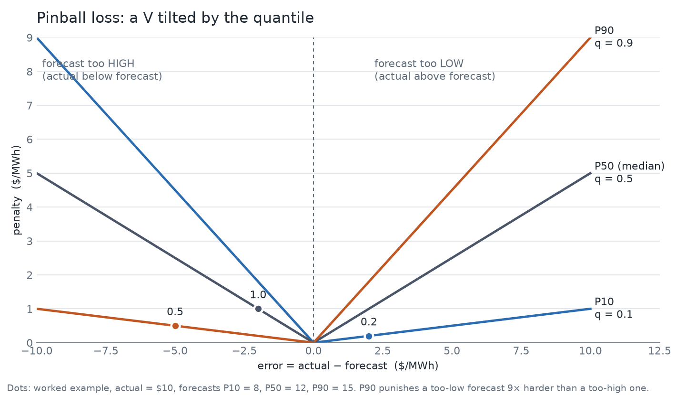

# Results: forecasting Victorian electricity prices with Chronos-2

How well can a pretrained time-series foundation model forecast the next day of electricity prices, compared with
simple baselines and a purpose-trained model, and does a short fine-tune help? This page has the results and what they
do and do not show. To install and re-run everything, see the [README](README.md).

## Summary

- **Zero-shot Chronos-2 matches a LightGBM we trained, with no training of its own.** It reads the last two weeks of
  prices and forecasts. Its error is statistically tied with a LightGBM trained on two years of the same data.
- **A 5-minute fine-tune makes it the best model, by a small margin.** Fine-tuned Chronos-2 beats both zero-shot
  (MAE $1.11/MWh lower) and LightGBM (MAE $1.74 lower, about 4%), and both gaps are unlikely to be luck.
- **Its uncertainty bands are better calibrated** than the trained quantile LightGBM: 76% to 78% of actual prices fall
  inside the P10-P90 band, against 69% for LightGBM (the target is about 80%).
- **All LightGBM and Chronos-2 variants beat "same as yesterday" by a wide margin** (MAE about $40 to $48 against $58),
  but **none predicts price spikes well**: on the top 5% of prices they miss by $228 to $270 on average.
- **Calendar features did not help**, and **about two weeks of history is enough**: 3 or 7 days is clearly worse,
  longer than 14 days is not clearly better.

## The task

For each of 635 forecast days (every NEM midnight from 1 Jan 2025 to 25 Oct 2026), predict the VIC1 regional reference
price for each of the next 48 half-hours, with a P10, P50 (median) and P90. 28 further days were skipped because the
actual prices had gaps. Inputs are the model's own price history (14 days by default) and, in one variant, calendar
features (half-hour of day, weekday, public holiday). Nothing from the forecast day itself is visible to a model.

**The data** is AEMO's public 5-minute dispatch price, averaged to 30 minutes (2023-01-01 to 2026-10-25). Over the test
period the average price is about $66/MWh (median $54), **23% of half-hours are negative**, and 0.65% exceed $300 with a
maximum of $14,649. A small number of extreme periods therefore dominate any squared-error metric, which is why the
tables report several measures. Prices were lower in 2026 (mean $52) than in 2025 ($78) or 2024 ($82), so the market
shifted during the test period.

**Training data** where a model needs it (LightGBM and the fine-tune) is 2023-01-01 to 2024-12-31 only. The test period
is never used for training, and the backtest refuses to score a day a trained model could have seen.

## The models

| Model | What it is |
|---|---|
| `naive_yesterday` | repeat the price from the same half-hour yesterday |
| `naive_last_week` | repeat the price from the same half-hour a week ago |
| `lightgbm` | gradient-boosted trees, one model each for P10/P50/P90, trained once on 2023-24 on lagged prices, recent price statistics and the calendar. Not refit during the test period. |
| `chronos2_zs` | Chronos-2 as published, no training on our data, reads the last 14 days |
| `chronos2_zs_cal` | the same plus calendar features as known-future covariates |
| `chronos2_ft` | Chronos-2 fine-tuned with LoRA on 2023-24 prices (1000 steps, 313 s on a Colab GPU, adapter 4.7 MB) |
| `chronos2_zs_ctx{3,7,28,42}d` | zero-shot with 3, 7, 28 or 42 days of history |

## Results

All numbers are in $/MWh, over the same 635 days and 30,480 half-hours. Lower is better, except coverage (about 80% is
ideal). "Spikes" means the top 5% of actual prices (at or above $181); "negative" means prices below zero.

| model | MAE | RMSE | MAE spikes | MAE negative | P10-P90 coverage | Pinball |
|---|---:|---:|---:|---:|---:|---:|
| naive_yesterday | 57.89 | 326.30 | 322.36 | 36.01 | – | – |
| naive_last_week | 74.09 | 349.20 | 360.19 | 50.50 | – | – |
| lightgbm | 41.76 | 246.13 | 236.86 | 30.04 | 68.6% | 14.98 |
| chronos2_zs | 41.14 | 244.38 | 231.68 | 26.98 | 76.6% | 14.57 |
| chronos2_zs_cal | 43.13 | 281.20 | 269.79 | 25.32 | 79.6% | 14.98 |
| **chronos2_ft** | **40.02** | **244.06** | **228.28** | 25.96 | 77.8% | **14.19** |
| chronos2_zs_ctx3d | 47.70 | 247.24 | 242.88 | 38.42 | 72.8% | 16.97 |
| chronos2_zs_ctx7d | 44.21 | 245.86 | 231.34 | 31.30 | 74.5% | 15.58 |
| chronos2_zs_ctx28d | 42.35 | 271.69 | 233.39 | 25.74 | 76.6% | 14.85 |
| chronos2_zs_ctx42d | 40.62 | 246.75 | 236.17 | 25.49 | 76.5% | 14.41 |

Pinball loss scores the whole P10/P50/P90 forecast in one number (a band that is too narrow or too wide scores worse):

Full tables with more detail: [`results/VIC1/metrics_vs_chronos2_zs.md`](results/VIC1/metrics_vs_chronos2_zs.md).

## Are the differences real?

Differences between models of $1 or $2 are small next to how much prices swing from day to day, so each comparison is
tested. Every model gets one error per forecast day, two models are compared day by day, and a block bootstrap (blocks of
7 consecutive days, 5,000 resamples) gives a 95% confidence interval for the average difference. `*` means the interval
excludes zero, i.e. the difference is unlikely to be luck. A positive difference means the model is worse than the
reference. This is a confidence interval, not a p-value, and no correction was made for the many comparisons.

Against zero-shot Chronos-2:

| model | MAE difference [95% CI] | better on % of days | pinball difference [95% CI] |
|---|---:|---:|---:|
| naive_yesterday | +16.75 [+11.71, +24.02] * | 23% | – |
| naive_last_week | +32.95 [+25.43, +43.21] * | 15% | – |
| lightgbm | +0.62 [-0.74, +1.92] | 46% | +0.41 [-0.15, +0.93] |
| chronos2_zs_cal | +1.99 [-0.37, +6.20] | 50% | +0.41 [-0.03, +1.14] |
| **chronos2_ft** | **-1.11 [-1.52, -0.77] \*** | 60% | **-0.39 [-0.55, -0.25] \*** |
| chronos2_zs_ctx3d | +6.56 [+5.32, +7.69] * | 30% | +2.40 [+1.84, +3.13] * |
| chronos2_zs_ctx7d | +3.08 [+2.30, +3.88] * | 35% | +1.00 [+0.72, +1.34] * |
| chronos2_zs_ctx28d | +1.21 [-1.03, +5.29] | 57% | +0.28 [-0.32, +1.36] |
| chronos2_zs_ctx42d | -0.51 [-1.14, +0.13] | 58% | -0.17 [-0.35, +0.03] |

Against LightGBM:

| model | MAE difference [95% CI] | better on % of days | pinball difference [95% CI] |
|---|---:|---:|---:|
| naive_yesterday | +16.13 [+10.77, +23.59] * | 27% | – |
| naive_last_week | +32.33 [+24.78, +42.46] * | 14% | – |
| chronos2_zs | -0.62 [-1.92, +0.74] | 54% | -0.41 [-0.93, +0.15] |
| chronos2_zs_cal | +1.37 [-1.81, +6.73] | 52% | +0.00 [-0.76, +1.17] |
| **chronos2_ft** | **-1.74 [-2.97, -0.49] \*** | 56% | **-0.79 [-1.26, -0.34] \*** |
| chronos2_zs_ctx3d | +5.94 [+4.28, +7.44] * | 35% | +1.99 [+1.36, +2.64] * |
| chronos2_zs_ctx7d | +2.45 [+1.06, +3.90] * | 42% | +0.59 [+0.12, +1.13] * |
| chronos2_zs_ctx28d | +0.59 [-2.38, +5.24] | 57% | -0.13 [-1.04, +1.15] |
| chronos2_zs_ctx42d | -1.14 [-2.44, +0.44] | 57% | -0.57 [-1.06, -0.01] * |

## What the results say

1. **The naive baselines are clearly beaten.** The gap ($17 to $33 MAE) is far outside the noise.
2. **Zero-shot Chronos-2 and LightGBM are tied.** The intervals include zero and Chronos-2 is better on only 54% of days.
3. **Fine-tuning gives a real but modest gain.** Better than zero-shot on 60% of days and better than LightGBM on 56%.
   About 2.7% lower MAE than zero-shot and 4% lower than LightGBM; pinball loss improves by a similar amount.
4. **Calibration:** both Chronos-2 variants have wider, better-calibrated bands than the trained LightGBM. Coverage is
   76.6% (zero-shot), 77.8% (fine-tuned) and 79.6% (with calendar), against 68.6% for LightGBM.
5. **Spikes are not solved.** MAE on the top 5% of prices is $228 to $270 for every Chronos-2 and LightGBM variant. A
   model that only sees past prices and the calendar cannot see a heatwave or an outage coming.
6. **Calendar features did not help.** Adding them made point accuracy and spike error worse (MAE 43.13 against 41.14),
   although the difference is not statistically clear, and it gave the lowest error on negative prices and the best coverage.
7. **Context length:** 3 and 7 days are clearly worse than 14 (the model needs at least a week or two to see the weekly
   pattern). 28 and 42 days are statistically tied with 14; 42 days is nominally the best zero-shot variant on MAE (40.62), but its gap to 14
   days is inside the noise.

## Why Chronos-2 is interesting

Electricity prices are a hard series for classical forecasting: spiky, heavy-tailed, 23% of the time negative, and the
market changes character from year to year. The usual approach is to build features and train a model per series.
[Chronos-2](https://huggingface.co/amazon/chronos-2) ([paper](https://arxiv.org/abs/2510.15821), Amazon, October 2025)
takes a different approach, and this project is a test of it on a real, awkward series.

- **It is a foundation model: nothing to train to get started.** It is a 120M-parameter encoder-only model pretrained on
  a large collection of real and synthetic series. You hand it the history and ask for a forecast. Here that was
  enough to tie a LightGBM we trained on two years of this exact data, with hand-built lag features.
- **It adapts through its context, not through retraining.** It re-reads the last 14 days every time it is asked. That
  matters when the market shifts: our 2026 prices are noticeably lower than 2024's (the 95th percentile fell from $251 to
  $138), and a model trained once on 2023-24 does not know that. (LightGBM here was deliberately trained once and not
  refit, which favours the foundation model: see the caveats.)
- **Probabilistic forecasts come built in.** It outputs quantiles directly, and in this test its bands were closer to
  the intended 80% coverage than the quantile LightGBM we trained for exactly that purpose.
- **It supports covariates in the same model**: both past-only (such as yesterday's demand) and known-future (such as
  tomorrow's calendar, weather forecast or AEMO's own pre-dispatch price forecast), real-valued or categorical. That is
  what makes it relevant to energy, where such inputs matter. We tested only the calendar here, and it did not help; the
  more promising covariates were not available consistently enough in our data (see next steps).
- **Adapting it is cheap.** A LoRA fine-tune trains a small adapter, not the whole model: 5 minutes on a free Colab
  GPU, a 4.7 MB file, and it produced a statistically clear improvement over both zero-shot and LightGBM.
- **It is practical.** Apache-2.0 licensed, loads with one line, runs on CPU (about a second per forecast on a laptop)
  or GPU with the same code, and the same pipeline accepts other models.

Put plainly, the result is not "Chronos-2 is dramatically more accurate". It is that **a pretrained model with no
feature engineering and no training reaches the accuracy of a purpose-trained model, with better-calibrated
uncertainty, and a few minutes of fine-tuning gets a small, real edge.** That makes it a strong, low-effort baseline
for energy price forecasting, and a good base to add real covariates to.

## Caveats and limits

- **One region and one period.** VIC1, 2025 to October 2026. The results do not say how the models behave elsewhere
  or in the future.
- **The LightGBM comparison is not fully symmetric.** LightGBM was trained once on 2023-24 and never updated, whereas
  zero-shot Chronos-2 reads recent history every day. A LightGBM refit regularly (walk-forward) might close part of the
  gap. LightGBM and the fine-tune use untuned default settings.
- **Fine-tuning is one run with one random seed** and untuned settings (1000 steps, learning rate 1e-5). The confidence
  intervals reflect which days were tested, not training randomness. Any tuning should be judged on a validation slice
  inside 2023-24, never on the test period.
- **Possible pretraining overlap.** Chronos-2's training data is not fully itemised, so some 2023-24 prices could in
  principle have been seen. Testing from 2025 onward reduces but does not remove that risk.
- **Confidence intervals are approximate.** The 7-day block length is a judgement, and no correction was made for the
  many comparisons, so borderline results (for example 42 days against zero-shot on pinball) deserve caution.
- **Squared-error metrics are dominated by a few spike days**, so RMSE and the intervals are wide and a few extreme days
  can move them.
- **Data gaps:** 130 half-hours of price (28 days) are missing in the source and the demand series ends on 9 Jul 2026.
  AEMO's pre-dispatch forecasts were not used because they are not available consistently enough.

## Next experiments

1. **Covariates that matter:** AEMO's pre-dispatch price and demand forecasts, weather forecasts, and past demand,
   passed to Chronos-2 as known-future and past-only covariates. This is where a covariate-aware model should help most.
2. **Fairer baselines:** refit LightGBM regularly (walk-forward), and tune each model on a validation split.
3. **More robust fine-tuning evidence:** several seeds, and a small search over steps and learning rate on a 2024
   validation slice.
4. **Spikes:** a dedicated approach (for example a spike probability) rather than hoping a median forecast catches them.
5. **Other regions, and other foundation models** (the model interface is built for adding them).

## Reproduce

Everything above can be regenerated from this repository: `make backtest` reproduces the tables from the saved
forecasts in seconds, and `make backtest ARGS="--force"` recomputes them. See the [README](README.md).
